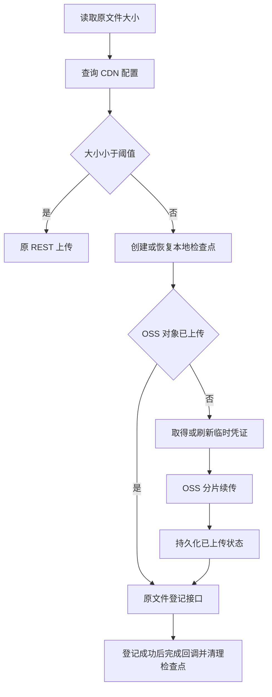

# BmobSDK 2.6.2 Android 功能对齐说明

本次 Android SDK 需要对齐三项能力：保持现有 BmobFile 调用方式的大文件分片断点续传、服务端会话检查、服务端退出登录。基准为 2026 年 10 月 26 日发布的 Objective-C BmobSDK 2.6.2。

沿用现有 SDK 的加密网络层、CDN 配置接口和文件登记接口，不增加 create、refresh、complete 上传任务接口。下列 JSON 是加密前的业务字段示意，省略现有网络层统一补充的鉴权字段，不能直接作为未加密 HTTP 请求发送。Android 公开方法名属于建议，最终应适配现有 SDK 的 Listener 和错误模型。

# 功能范围与兼容要求

| 能力 | Android 目标 |
| --- | --- |
| 文件上传 | 保留 BmobFile 的上传、进度、批量、取消和删除接口；SDK 内部选择上传通道 |
| 上传阈值 | 从 CDN 配置读取原始字节数，缺省 10485760；小于阈值走原 REST，等于及以上走 OSS |
| 断点续传 | 分片上传、取消后重试、重启后重新调用恢复、跨天恢复、登记失败只重试登记 |
| 会话检查 | 返回有效或失效；网络、服务端及格式错误单独返回 |
| 服务端退出 | 新增异步网络方法；原有本地退出方法保持原语义 |

只上传小文件的旧客户端可继续使用现有 REST 通道。大文件新能力需要升级 Android SDK，并接入支持临时凭证的服务端。不要把 Objective-C 版本号 2.6.2 当作 Android 的版本号。

# 上传通道选择

上传前读取原始文件大小，使用 long，避免整文件读入内存或使用 Base64 后长度判断。通过现有 POST /8/cdn 查询配置：

```json
{
  "data": {
    "filesize": 31457280
  }
}
```

先检查业务 result.code，再读取 data.cdn。阈值有效时使用服务端值；字段不存在、非正值或无法解析时使用 10485760 字节。此处“10MB”精确定义为 10 × 1024 × 1024 字节。

| 原始文件大小 | 默认通道 |
| --- | --- |
| 10485759 字节 | 现有 REST 上传 |
| 10485760 字节 | OSS 分片续传 |
| 31457280 字节 | OSS 分片续传 |

CDN 配置请求失败时，小于默认阈值的文件允许走原 REST；大文件返回配置错误。已取得有效 CDN 配置时以该配置阈值为准。选中大文件直传后，若平台不支持或缺少 STS 凭证，应返回明确错误，不静默回退整文件 REST。

建议上传抽象按 platform 选择 provider，先实现 aliyun，保留现有平台兼容分支，避免将 OSS 类型暴露到 BmobFile 公共 API 中。

# CDN 配置字段

成功响应示意，所有凭证均为占位值：

```json
{
  "result": { "code": 200 },
  "data": {
    "cdn": {
      "platform": "aliyun",
      "uploadThreshold": 10485760,
      "aliyun": {
        "name": "YOUR_BUCKET",
        "domain": "files.example.com",
        "region": "cn-hangzhou",
        "endpoint": "oss-cn-hangzhou.aliyuncs.com",
        "uploadPrefix": "2026/10/26/",
        "uploadScope": "bmob/YOUR_APP_ID/",
        "credentials": {
          "accessKeyId": "TEMPORARY_ACCESS_KEY_ID",
          "accessKeySecret": "TEMPORARY_ACCESS_KEY_SECRET",
          "securityToken": "TEMPORARY_SECURITY_TOKEN",
          "expiration": "2026-10-26T09:00:00Z"
        }
      }
    }
  }
}
```

| 字段 | 含义 |
| --- | --- |
| name | OSS bucket，直接作为上传空间名 |
| domain | 文件访问域名，保留现有 SDK 的协议与 URL 拼接约定 |
| endpoint / region | OSS 上传端点及地域；不能拿 CDN 访问域名替代上传端点 |
| uploadPrefix | 新对象路径的目录前缀，由服务端给出 |
| uploadScope | 稳定的检查点命名空间；不是 bucket，也不是对象路径 |
| credentials | STS 临时凭证，必须同时具有 ID、Secret、Token 和有效到期时间 |
| credentialError | STS 签发失败时可能返回；不能因外层 code=200 就认为直传可用 |

小文件请求可以没有 credentials，不应因此阻止 REST 上传。长期 OSS AccessKey、STS RoleArn 由服务端管理，Android 不配置永久密钥，也不直接调用 AssumeRole。日志不得输出临时 Secret、SecurityToken 或用户 sessionToken。

# 对象路径与上传状态

新文件使用服务端 uploadPrefix，加上去掉连字符的 32 位随机 UUID，再保留原文件扩展名。例如：

```text
bucket:    YOUR_BUCKET
objectKey: 2026/10/26/c65b80fd4095d47d801528e98185fa67.jpg
```

objectKey 不带开头斜杠。不要把路径生成成 bmob/应用ID/文件名；uploadScope 只参与本地检查点身份。最终公开 URL 使用返回的 CDN 域名和该对象路径，沿用现有 SDK 的 URL 规则。



OSS CompleteMultipartUpload 成功后要先持久化“对象已上传”状态，再调用文件登记。登记失败或响应丢失时保留此状态；下次重试只登记同一对象，不生成新 key、不重新上传内容。

# Android 续传实现要求

建议采用阿里云官方 Android OSS SDK 的可恢复分片上传能力，SDK 版本由 Android 工程结合 minSdk、网络库和混淆配置选定。iOS 本次使用 2 MiB 分片；Android 可先以相同大小作为起点，并遵守所选 OSS SDK 的分片限制。

实现时区分两层记录：Bmob 保存对象身份、原始文件信息、objectKey 和登记状态；OSS SDK 保存 uploadId、已完成分片等上传记录。不能只保留 OSS 的断点文件而丢失 Bmob 对象身份。

建议以应用命名空间、bucket、原文件名、内容 SHA-256 识别同一任务。iOS 的稳定命名空间使用 uploadScope，日期变化不应改变检查点身份。哈希和文件读写放到后台线程，使用流；对只提供内存数据的入口可落到 SDK 私有文件。

检查点放在应用私有持久目录，避免放在可能随时被清理的临时缓存中，并排除自动备份；不要持久化长期凭证。若文件来源为 content URI，需保证重启后仍可读，或在 SDK 私有目录保存可恢复的源文件。

取消应停止当前请求并保留恢复记录，不主动销毁 multipart 任务。再次使用同名同内容原文件调用现有上传方法时恢复。App 重启后由业务重新发起，不承诺自动后台上传。成功登记后清理检查点、分片记录和 SDK 创建的临时源文件，不删除用户原文件。

同一任务避免并发上传；使用任务标识或代次屏蔽取消后到达的旧回调。重试时校验文件内容、bucket 与命名空间；bucket 变化时停止恢复，不能混用另一 bucket 的 uploadId。

进度沿用 Android 现有公开量纲。只有文件登记成功才报告最终 100% 和成功回调；恢复上传时应体现已完成分片，不能把 OSS 上传完成误报为整个 BmobFile 成功。批量上传沿用现有聚合语义。

# 凭证刷新与跨天续传

解析 expiration 为 UTC 时间，并在接近过期时刷新；iOS 当前提前 120 秒检查。通过原 CDN 接口刷新，仍然使用现有加密网络层：

```json
{
  "data": {
    "filesize": 31457280,
    "directUpload": true,
    "objectKey": "2026/10/26/c65b80fd4095d47d801528e98185fa67.jpg"
  }
}
```

directUpload=true 让服务端继续为已开始的直传任务签发凭证，避免上传中阈值调整阻断恢复。objectKey 必须来自原检查点；服务端会按原对象目录授权，返回相应 uploadPrefix。

跨到 10 月 27 日重试时仍上传 10 月 26 日的 objectKey。初次查询可能返回新日期凭证，恢复旧目录任务时需要带原 objectKey 刷新，不能直接使用新目录权限。兼容已有 bmob/应用ID/ 目录的未完成任务时保留原路径，不搬迁既有对象。

配置失败、STS 过期且刷新失败应返回可诊断错误，不无限重试。服务端遇到 EntityNotExist.Role，应检查真实 RAM 角色 ARN；user/... 不能替代 role/...。Android 仅透传安全的诊断信息，不负责控制台授权配置。

# 文件登记与删除

OSS 上传完成后继续 POST /8/savecdnupload：

```json
{
  "data": {
    "filename": "photo.jpg",
    "url": "/2026/10/26/c65b80fd4095d47d801528e98185fa67.jpg",
    "filesize": 31457280,
    "cdn": "aliyun"
  }
}
```

filename 是原始文件名，filesize 是原始字节数，url 在当前 iOS 实现中是带开头斜杠的对象相对路径，不是 CDN 完整 URL。cdn 使用 aliyun。按现有 SDK 约定补充请求公共字段。

result.code=200 才认为登记成功。重试必须提交相同路径，复用服务端已有的 OSS 登记幂等处理。公开 BmobFile 保留原始文件名、完整访问 URL 和 CDN 标识；不能用相对登记路径覆盖公开 URL。

小文件继续沿用原 /8/files 的编码、请求字段和响应解析，不需要先改造这条链路。删除继续使用既有 /8/delcdnupload 协议及存储路径约定；保留正确的 cdn，不因本次改造改变业务删除调用方式。

# 服务端会话检查

建议在 BmobUser 增加“检查当前用户”和“显式检查 objectId 与 token”两个异步入口，名称适配 Android 现有规范。可用返回 Boolean 的 Listener 或等效结果类型，必须区分 false 与请求错误。

POST /8/check_session 的业务字段：

```json
{
  "c": "_User",
  "objectId": "USER_OBJECT_ID",
  "sessionToken": "USER_SESSION_TOKEN"
}
```

objectId 和 sessionToken 位于顶层，不能把 objectId 放入 data。显式入口应发送传入的 token，不得被网络层的全局当前 token 覆盖。

```json
{
  "result": { "code": 200 },
  "data": { "msg": "ok" }
}
```

| 情况 | 对外语义 |
| --- | --- |
| code=200 且 msg=ok | 有效，true，无错误 |
| code=200 且 msg=fail | 失效，false，无错误 |
| 当前用户入口缺少本地 ID 或 token | false，无错误，不发请求 |
| 显式入口缺少参数 | 参数错误，不发请求 |
| 非成功业务 code、网络错误 | 保留错误，不转成会话失效 |
| 缺失 msg 或未知 msg | 协议解析错误 |

本地 currentUser 非空不代表服务端会话有效。检查不自动清缓存、不刷新 token、不修改当前登录用户，不应因断网就触发业务强制登出。

# 服务端退出登录

保留 Android 原有本地退出方法，另增异步服务端退出入口及可显式传入 objectId、token 的入口。不要给原同步方法偷偷增加网络副作用。

POST /8/logout 的业务字段：

```json
{
  "c": "_User",
  "sessionToken": "USER_SESSION_TOKEN",
  "data": {
    "objectId": "USER_OBJECT_ID"
  }
}
```

注意这里 objectId 在 data 内，与 check_session 不同。成功响应同样是 result.code=200 且 data.msg=ok。缺少参数返回参数错误；业务、网络及格式错误保留，失败时不自动清理本地会话。

成功后，只有当当前缓存的 objectId 和 sessionToken 都仍等于本次退出的值时，才清理当前用户和 token。若请求期间已登录另一个用户或同一用户的新 token，旧退出响应不得清除新登录状态。显式退出其他用户也不得清除当前用户。

服务端会验证 token 并使会话过期。不要默认重复调用一定成功；无效 token 可能返回错误。会话检查与退出的回调沿用 Android SDK 对外线程约定，UI 示例应在主线程更新。

# 验收用例

| 类别 | 场景 | 预期 |
| --- | --- | --- |
| 阈值 | 1 MiB、10 MiB、30 MiB | 默认依次 REST、OSS、OSS |
| 边界 | 阈值减一字节、恰好阈值 | 分别 REST、OSS |
| 配置 | 阈值改为 20 MiB；字段缺失或非正值 | 使用配置值；无效配置回退 10 MiB |
| 降级 | CDN 查询失败 | 小于默认阈值可 REST；大文件明确失败 |
| STS | 小文件无凭证、大文件无凭证 | 小文件仍成功；大文件报配置错误 |
| 路径 | 首次上传、跨天重试 | 新对象使用服务端日期；恢复沿用原 key |
| 恢复 | 30 MiB 断网、取消、进程结束后重试 | 重新发起可恢复已完成分片 |
| 凭证 | 上传中到期、刷新失败 | 可刷新继续；失败明确报错且保留恢复状态 |
| 阈值变化 | 已开始 OSS 后阈值调大 | directUpload=true 仍能刷新并继续 |
| 登记 | OSS 成功后登记失败或响应丢失 | 重试同一对象登记，不重复上传内容 |
| 完成 | OSS 完成但尚未登记 | 不提前报告 100% 或成功 |
| 文件变化 | 同名但内容改变、bucket 改变 | 不错误复用原分片 |
| 并发 | 取消后旧回调到达、同任务重复启动 | 不重复完成或污染新任务 |
| 兼容 | 旧小文件上传、批量上传、文件删除 | 原公开调用方式及结果保持兼容 |
| 会话检查 | 有效、过期、未登录、错误 token、断网、异常响应 | 按会话检查表区分结果与错误 |
| 显式会话 | 当前 A，显式检查 B | 检查 B 的 token，不改变 A |
| 服务端退出 | 成功、失败、缺参数 | 成功清匹配缓存，失败保留缓存 |
| 登录竞态 | 退出 A 过程中登录 B 或 A 的新 token | 旧退出响应不清理新会话 |

建议 Android Demo 增加 1 MiB、10 MiB、30 MiB 测试入口，展示通道、上传及登记阶段、进度、耗时、错误、取消和重试；提供会话检查与服务端退出入口。调试日志记录请求阶段、对象路径及非敏感错误，不记录凭证值。

联调沿用 SDK 的域名配置机制，当前测试服务为 http://opentest.codenow.cn/。Android 如需明文 HTTP，应仅在调试构建配置该域名例外，正式环境使用业务配置的域名。

# 开发拆分与参考

建议顺序：先实现阈值解析和 provider 分流，再实现对象身份与检查点、OSS 分片与 STS 刷新、文件登记恢复，最后补上会话检查与服务端退出，并用验收矩阵完成联调。服务端继续复用现有接口，Android 不需要实现新的上传任务服务。

iOS 特有的 Network.framework、libresolv.tbd、Objective-C 桥接和 xcframework 架构配置不属于 Android 依赖项。Android 需按实际 OSS SDK 补充 Gradle 依赖、Manifest、混淆和许可证；避免业务侧重复引入不同版本 OSS 导致冲突。

公开版本基准：[Bmob-iOS-SDK 2.6.2](https://github.com/bmob/Bmob-iOS-SDK/tree/2.6.2)。重点可核对发布包的 BmobFile.h、BmobUser.h、README 与更新历史。

内部实现参考：
- iOS BmobFile.m：通道分流、登记、取消和最终完成语义。
- iOS SharedUpload/BmobOSSUploadManager.m：检查点、对象路径、分片及凭证刷新。
- 服务端 api/newcontrollers/cdn.go、savecdnupload.go、check_session.go、logout.go：加密 SDK 接口。
- 服务端 api/newcontrollers/base.go：请求转发和字段位置。
- 服务端 restful/controllers/newfile.go、oss_upload_credentials.go、user.go：CDN、STS、登记、会话检查和退出实现。

交付物应包含 Android SDK 实现、Demo、自动化边界及状态测试、上述联调用例结果、Android 用户文档与更新日志。此说明定义待实现行为，不代表 Android SDK 已支持这些新增能力。
